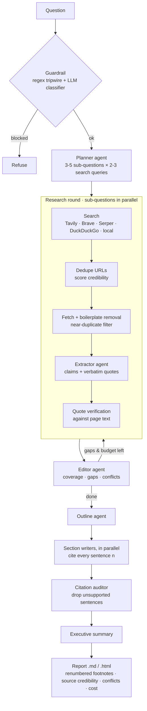

<div align="center">

# Meridian

**An autonomous deep-research agent that produces analyst-grade, fully cited reports, and fact-checks its own citations before you read them.**

   

</div>

Give Meridian a question like *"How do sodium-ion batteries compare with LFP for grid storage?"* It then:
1. plans the research,
2. sends parallel researcher agents to search the web,
3. reads and scores the sources,
4. extracts claims with verbatim quotes,
5. has an editor agent look for gaps and contradictions, and runs another round if needed,
6. writes the report section by section,
7. audits every citation, so a sentence that its source doesn't support gets removed.

You get a Markdown or HTML report with numbered footnotes, a "where sources disagree" section, credibility notes for every source, and a full trace of what it cost.

## Why I built this

"Deep research" products are impressive, but they share three failure modes:

| Failure mode | What Meridian does about it |
|---|---|
| **Citation laundering**: a sentence has a footnote, but the source doesn't say that | A citation audit pass checks every cited sentence against the evidence from that source. It removes unsupported sentences and citations to sources that don't exist. Extracted quotes are also checked verbatim against the page text. |
| **Garbage in**: a content-farm listicle carries the same weight as a government report | Credibility scoring (domain type, recency, self-interest), a minimum-credibility floor, credibility-ordered reading, and near-duplicate detection, so a syndicated copy doesn't count as independent confirmation |
| **False certainty**: when sources disagree, the model silently picks one | The editor agent explicitly detects conflicts. The report gets a *Where sources disagree* section citing both sides. |

It also has hard **budgets**: LLM calls, dollars and wall-clock time. When a budget runs out, the agent writes up what it has instead of crashing or running up a bill.

## Architecture



**Design notes**
- **Planner / worker / editor** is the same split real research teams use. Each role is one small function around one schema-validated LLM call ([`agents/roles.py`](src/meridian/agents/roles.py)), so every role can be unit-tested and pointed at a different model. For example, a cheap `MERIDIAN_FAST_MODEL` for the high-volume extraction step and a strong model for writing.
- **Bounded parallelism.** Sub-questions, page reads and section drafts fan out on thread pools. `pmap` copies `contextvars` into each worker, so tracing spans still nest correctly across threads.
- **Iterative deepening.** Round 2 researches *only* the gaps the editor found, not the whole plan again.
- **Sources are shared across sub-questions.** A page is fetched once and can be mined for several sub-questions. Search and fetch results are cached in SQLite, which makes re-runs fast and reproducible.
- **Citations are renumbered** 1..n in order of first appearance, and only cited sources are listed.

## Benchmark: an offline "synthetic web"

`benchmark/` holds a small invented web (16 pages, all fictional) about a grid-scale sodium-ion battery market. It's built to trip a research agent up:

| Page type | What it tests |
|---|---|
| Government report, IEA-style outlook, peer-reviewed review | high-credibility facts the report should use |
| Content-farm *"Top 10 stocks"* page with an inflated market size (USD 6B vs 1.8B) | credibility weighting: this must never be stated as fact |
| A 2019 page with outdated costs (USD 120/kWh) | recency penalty |
| A syndicated copy of a news story on another domain | near-duplicate filtering |
| Two outlets disagreeing on a plant's capacity (12 vs 10 GWh) | conflict detection |
| Company press releases ("world's largest", "175 Wh/kg") | self-interest discount |
| An off-topic recycling article | relevance filtering |

There are 4 research questions, each with **required facts** (should appear in the report) and **trap facts** (should not be stated as fact). Metrics:
- fact recall
- trap rate
- mean credibility of cited sources
- number of low-credibility sources cited
- conflicts surfaced
- unsupported sentences removed
- LLM calls, tokens, cost and latency

```bash
meridian bench            # with your configured LLM → benchmark/results/results.md
meridian bench --offline  # scripted model: validates the pipeline end-to-end (runs in CI)
```

In CI the offline run gates the parts of the pipeline that don't depend on the model's prose quality. Source selection currently gives a mean credibility of cited sources of **0.93**, **0** low-credibility sources cited and a trap rate of **0**. Adding the credibility floor and cross-sub-question source sharing moved cited-source credibility from **0.71 to 0.93**.

## Quick start

```bash
pip install -e ".[dev]"
make demo                     # full multi-agent pipeline offline: no API keys at all

cp .env.example .env          # add an LLM key (OpenAI / Groq / OpenRouter / local Ollama)
meridian research "What are the main risks for India's quick-commerce companies in 2026?"
meridian serve                # web console at http://localhost:8000 with live agent activity
```

Reports are written to `reports/<question>.md` and `.html`. Web search defaults to DuckDuckGo, which needs no key. For production, set `MERIDIAN_SEARCH_PROVIDER=tavily|brave|serper`.

### API
| Method | Path | Description |
|---|---|---|
| `POST` | `/api/research` | `{question}` → SSE stream: `plan`, `round`, `sources`, `evidence`, `review`, `outline`, `drafted`, `verified`, `budget`, `done`, `report` |
| `GET` | `/api/reports/{id}.md` · `.html` | download a finished report |
| `GET` | `/api/traces/{id}` | span tree: every agent step with latency, tokens and cost |

## Project layout

```
src/meridian/
  orchestrator.py     planner → parallel researchers → editor loop → writers → auditor; budgets; pmap
  agents/roles.py     guardrail, planner, extractor (+ quote verification), editor, outliner, writer, auditor
  tools/              search providers (+ local corpus) · fetch & readable-text extraction · SQLite cache
  credibility.py      explainable source scoring · shingle/Jaccard near-duplicate detection
  report.py           Markdown / HTML rendering with footnotes
  eval/bench.py       research-quality benchmark (fact recall, trap rate, citation credibility…)
  api/                FastAPI + SSE + live console
  llm.py · tracing.py OpenAI-compatible client with retries & cost accounting · span tracing
benchmark/            synthetic web + questions   ·   scripts/build_benchmark.py regenerates them
tests/                21 tests: tools, credibility, dedup, quote checks, every orchestration branch, API
```

## Roadmap
- Claim-level cross-source corroboration score (agreement across independent domains)
- Human-in-the-loop plan approval before research starts
- Scheduled monitoring mode: re-run a question weekly and diff the findings
